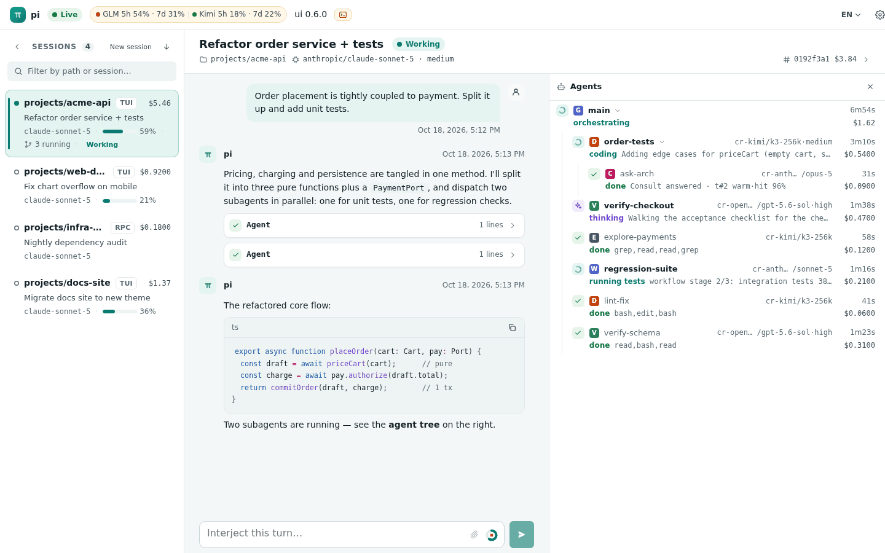
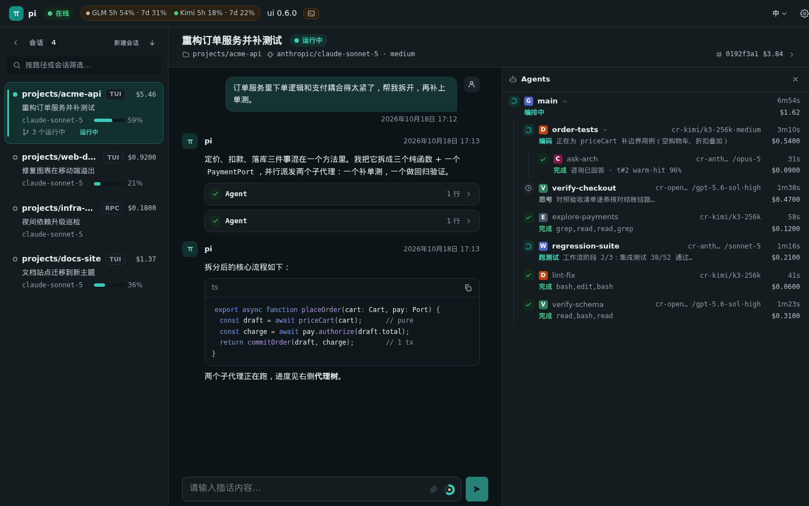
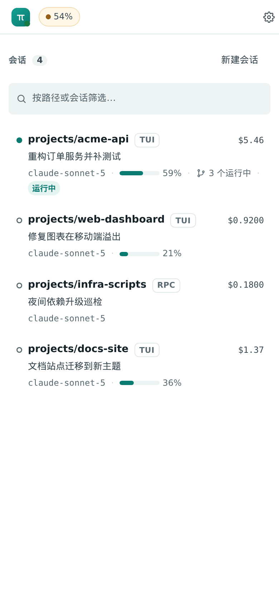
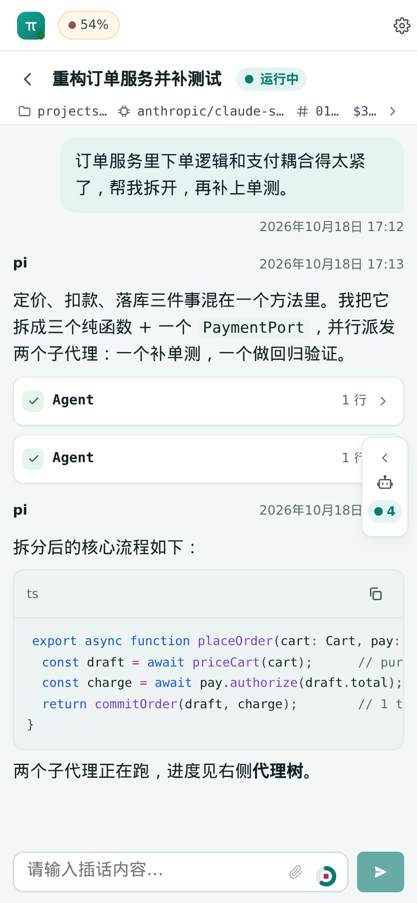
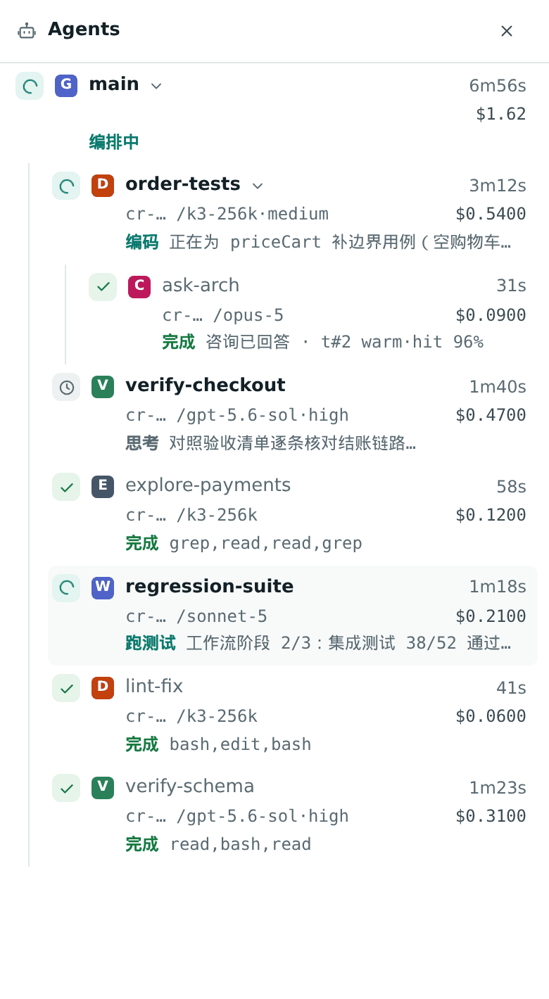
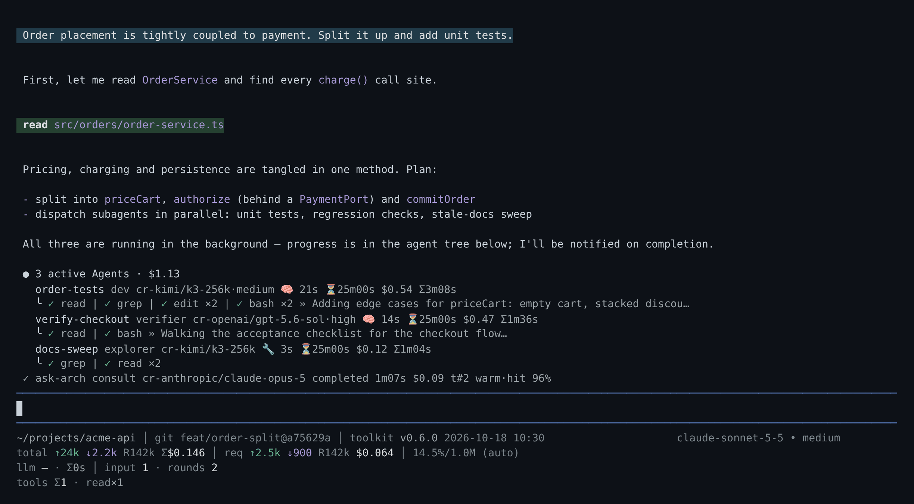

# pi-toolkit

[中文](README.md) | **English**

A toolbox extension for [pi](https://github.com/earendil-works/pi). The flagship is a **zero-hang subagent system** (`Agent` / `get_subagent_result` / `steer_subagent` / `SubagentWorkflow`), plus a set of everyday modules you can toggle independently: project memory, context handoff and cache keepalive, quota and load awareness, bash auto-backgrounding, task tools, `/goal`, Feishu notifications, and an optional browser control plane (Web Hub). One install entry, one settings gate.

<p align="center">
  
  <br>
  <sub>Web UI: sessions, transcript, agent tree (phases / cost / consult cache hit) and subscription quota in one view</sub>
</p>

<p align="center">
  
  
  
  
  <br>
  <sub>Dark theme · mobile (sessions / chat / agent drawer)</sub>
</p>

## Core properties

<p align="center">
  
  <br>
  <sub>In the terminal: agent-tree widget + HUD footer</sub>
</p>

1. **Zero-hang** — every subagent run is a pure state machine with per-phase deadlines: a 1Hz watchdog fires them, an escalation ladder (cancel → steer → abort → dispose) reclaims resources, and anything that still refuses to die is registered as an orphan. Every run reaches a terminal state.
2. **Observable** — a live agent tree sits above the editor (phase, in-flight tool, streaming tail, real-time cost); `/agent status` gives a per-run tool timeline; Web Hub shows the same.
3. **Results always delivered** — completion notices flow through a persistent, acknowledgeable delivery pipeline and are never silently dropped.
4. **Dispatch and walk away** — main-session `Agent` and `SubagentWorkflow` calls always run in the background and return an id immediately; completion notices drive the next step. bash commands past a threshold (default 290s) are moved to the background without being killed.
5. **A toolbox, not a monolith** — every module beyond the subagent core has its own switch. Install one package, take what you need.

## Install

pi loads TypeScript source directly (via jiti) — no build step:

```sh
pi install git:github.com/Newbluecake/pi-toolkit
# update:
pi update --extension git:github.com/Newbluecake/pi-toolkit
```

Or download the total zip from [GitHub Releases](https://github.com/Newbluecake/pi-toolkit/releases). Extract it, then run in the extracted directory:

```sh
cd pi-toolkit
npm install --omit=dev
pi install .
```

The total zip installs as a local pi extension (local-path install, not covered by `pi update`). The Web UI also ships as a separate `pi-toolkit-web-ui-<version>.zip` asset: extract it into `~/.pi/agent/` to install it under `~/.pi/agent/web-hub-ui/<version>/`, no hub restart needed.

## Modules

Detailed guides live in [`docs/guide/`](docs/guide/) and are **written in Chinese only**; internal design docs are in [`docs/dev/`](docs/dev/) (also Chinese).

| Module                            | What it does                                                                                                                                                                                                                                                                                                    | Guide (zh)                                                       |
| --------------------------------- | --------------------------------------------------------------------------------------------------------------------------------------------------------------------------------------------------------------------------------------------------------------------------------------------------------------- | ---------------------------------------------------------------- |
| Subagent tools                    | `Agent` / `get_subagent_result` / `steer_subagent` / `abort_subagent` / `extend_subagent_timeout` / `set_model`; background, extendable timeouts, optional worktree isolation.                                                                                                                                  | [subagents](docs/guide/subagents.md#工具)                        |
| Agent tree                        | Live subagent tree above the editor: phases, tool trail, cost, deadline highlights.                                                                                                                                                                                                                             | [subagents](docs/guide/subagents.md#agent-tree)                  |
| SubagentWorkflow                  | Sandboxed JS orchestration (`agent()` / `parallel()` / `pipeline()`), background, journal replay. Off by default.                                                                                                                                                                                               | [subagents](docs/guide/subagents.md#subagentworkflow)            |
| Scheduled tasks                   | cron / interval / once jobs loaded from a JSON file that dispatch subagents.                                                                                                                                                                                                                                    | [subagents](docs/guide/subagents.md#定时任务)                    |
| Anti-hang architecture            | Per-phase deadlines, escalation ladder, orphan registry, persistent notice delivery.                                                                                                                                                                                                                            | [subagents](docs/guide/subagents.md#防卡死架构)                  |
| Message fabric                    | Fire-and-forget messages between subagents along the agent tree (`message_agent`). Off by default.                                                                                                                                                                                                              | [subagents](docs/guide/subagents.md#message-fabric)              |
| consult experts                   | A child run synchronously asks a finished expert run, or the main session, within one turn (`consult`).                                                                                                                                                                                                         | [subagents](docs/guide/subagents.md#consult-专家咨询)            |
| External droid agent              | Dispatch Factory droid as the virtual provider `droid/<model>`, with a model allowlist and quota gate. Off by default.                                                                                                                                                                                          | [subagents](docs/guide/subagents.md#外部-droid-agent)            |
| Project memory                    | cwd-keyed passive memory: tiered injection, `memory` tool, `/mem doctor` / `tidy`.                                                                                                                                                                                                                              | [memory](docs/guide/memory.md)                                   |
| bash auto-background              | Overrides built-in `bash`: long commands move to the background unkilled; `bash_job` manages them; grace and extension.                                                                                                                                                                                         | [bash](docs/guide/bash.md)                                       |
| Context handoff and usage hints   | `switch_context` / `compact_context`, stepped usage ticks and a force line.                                                                                                                                                                                                                                     | [context](docs/guide/context.md#switch_context--compact_context) |
| cache TTL and keepalive           | Anthropic prompt-cache TTL modes and keepalive pings with breakers and an evidence layer.                                                                                                                                                                                                                       | [context](docs/guide/context.md#cache-ttl-与保活)                |
| System-prompt stabilization       | Dynamic sections become a frozen snapshot; changes ride tail messages so the cached prefix survives.                                                                                                                                                                                                            | [context](docs/guide/context.md#system-prompt-稳定化)            |
| Date injection                    | Injects `[date]` on the first turn, at day rollover and after long idle.                                                                                                                                                                                                                                        | [context](docs/guide/context.md#date-日期注入)                   |
| Quota awareness                   | GLM / Kimi subscription and droid Standard / Core pool quota: laddered warnings, dispatch gate, Core→Standard fallback.                                                                                                                                                                                         | [quota-load](docs/guide/quota-load.md#额度感知quota)             |
| Load awareness                    | CPU / memory / IO / disk sampling; defers new dispatches while the machine is busy.                                                                                                                                                                                                                             | [quota-load](docs/guide/quota-load.md#负载感知派单load)          |
| Task tools                        | Five `Task*` tools + widget + `/tasklist`; finished tasks collapse and auto-archive.                                                                                                                                                                                                                            | [tools](docs/guide/tools.md#任务工具todo)                        |
| `/goal`                           | Objective-driven loop judged by a deterministic command or a verifier subagent, with turn / budget / time brakes.                                                                                                                                                                                               | [tools](docs/guide/tools.md#goal-目标循环)                       |
| `ask_user` / `web_search`         | Structured interactive questions; web search with four-provider failover.                                                                                                                                                                                                                                       | [tools](docs/guide/tools.md#ask_user)                            |
| HUD footer                        | Takes over pi's footer: git, tokens / cost, context, quota / load.                                                                                                                                                                                                                                              | [tools](docs/guide/tools.md#hud-footer)                          |
| Feishu notifications              | Passively triggered result / summary / heartbeat cards (`@notify`, `/watch`).                                                                                                                                                                                                                                   | [tools](docs/guide/tools.md#飞书通知)                            |
| Session navigation                | `/resume-recent`, `/clear`, bare `exit`, title cleaning.                                                                                                                                                                                                                                                        | [tools](docs/guide/tools.md#会话导航)                            |
| topic-switch                      | Suggests a fresh session when a new request is unrelated and the cache is cold.                                                                                                                                                                                                                                 | [tools](docs/guide/tools.md#topic-switch)                        |
| Auto title / deferred `/reload`   | A small model titles sessions; `/reload` waits while subagents are running.                                                                                                                                                                                                                                     | [tools](docs/guide/tools.md#自动标题)                            |
| Web Hub (optional)                | Browser view and control: web prompts, `ask_user` race, managed sessions and restore, file / sandboxed HTML preview, local-port proxy, worktree diff / graph, version panel, LAN password and security (client IP allowlist, two-factor login, login session management, Feishu security alerts), privacy lock. | [web-hub](docs/guide/web-hub.md)                                 |
| Migrating from standalone plugins | Uninstalling the old plugins and spotting leftovers.                                                                                                                                                                                                                                                            | [migration](docs/guide/migration.md)                             |

## Commands

| Command                                                                  | What it does                                                                                                        |
| ------------------------------------------------------------------------ | ------------------------------------------------------------------------------------------------------------------- |
| `/agent` (`status [runId]` / `costs` / `settings` / `budget` / `reload`) | Run diagnostics, cost breakdown, settings editor, deferred reload                                                   |
| `/task <description>`                                                    | Start a background general-purpose subagent                                                                         |
| `/goal`                                                                  | Objective loop (`status` / `pause` / `resume` / `clear`)                                                            |
| `/mem`                                                                   | Project memory: `list` / `path` / `import` / `doctor` / `tidy` / `restore`                                          |
| `/tasklist`                                                              | Task panel (`clear` empties it)                                                                                     |
| `/cache-ttl`                                                             | `on` / `off` / `auto` / `save` / `keepalive on\|off\|reset` / `status` / `probe`                                    |
| `/topic-switch`                                                          | Show state (`status`); `last [--send]` retrieves the last held request                                              |
| `/webhub`                                                                | `status` / `open` / `restart` / `stop` / `start` / `token rotate` / `passwd` / `unlock` / `2fa` / `user` / `feishu` |
| `/watch`                                                                 | Notify Feishu every time a task ends in this session                                                                |
| `/feishu-test`                                                           | Send a Feishu test card                                                                                             |
| `/pi-hud-refresh`                                                        | `git fetch` and refresh the HUD                                                                                     |
| `/resume-recent`                                                         | Resume sessions from the last 48 hours (`--all` for everything)                                                     |
| `/clear`                                                                 | Start a new session                                                                                                 |

## Configuration

User settings file: `~/.pi/agent/pi-subagent.json` (historical file name kept; a missing or malformed file falls back to defaults and never throws).

- `/agent settings` opens an interactive editor (↑↓ select, Enter edit, Space toggle booleans, `r` reset to default; changes persist immediately). For scripts use `/agent settings list` / `set <key> <value>` / `reset <key>`.
- **Time fields normally use integer seconds** (keys end in `S`, e.g. `budget.idleS`); legacy millisecond keys are migrated on first load. Exception: `feishuBot.debounceMs` below remains in milliseconds and is not migrated.
- Per-module keys and defaults are in the matching guide (Chinese).

Top-level enable switches (defaults in the comments):

```jsonc
{
  "workflow": { "enabled": false }, // SubagentWorkflow
  "fabric": { "enabled": false }, // message_agent
  "worktree": { "enabled": false }, // isolation: "worktree"
  "memory": { "enabled": true },
  "hud": { "enabled": true },
  "webSearch": { "enabled": true },
  "todo": { "enabled": true },
  "askUser": { "enabled": true },
  "feishuNotify": { "enabled": true },
  "sessionNav": { "enabled": true },
  "goal": { "enabled": true },
  "consult": { "enabled": true },
  "quota": { "enabled": true },
  "load": { "enabled": true },
  "topicSwitch": { "enabled": true },
  "date": { "enabled": true },
  "externalAgents": { "droid": { "enabled": false } },
  "webHub": { "enabled": false },
  "feishuBot": { "enabled": false }, // Feishu bot; requires Web Hub control
}
```

`web_search` provider credentials live elsewhere; see the [tools guide](docs/guide/tools.md#web_search) (Chinese).

### Feishu bot settings (optional)

These are **top-level** `feishuBot.*` keys in `pi-subagent.json`, not `webHub.feishuBot`. Changes require `/reload` then `/webhub restart`. Requires `webHub.enabled:true` and control enabled. [Setup, commands and security](docs/dev/feishu-bot/README.md) · [real-tenant checklist](docs/dev/feishu-bot/acceptance.md) (Chinese). **One app connects to one hub**; concurrent connections split events.

| Key                             | Default   | Meaning                                                                               |
| ------------------------------- | --------- | ------------------------------------------------------------------------------------- |
| `feishuBot.enabled`             | `false`   | Enable bot (owner-only by default).                                                   |
| `feishuBot.allowGroups`         | `true`    | Accept group @bot messages.                                                           |
| `feishuBot.groupRootTopics`     | `false`   | Open an unbound topic from a group-root @; then explicitly /use or /new.              |
| `feishuBot.notify`              | `"bound"` | bound / off; proactive done/failed/waiting for bound sessions.                        |
| `feishuBot.spawnScope`          | `"known"` | known refuses unknown dirs; roots requires path confirmation. /new also needs spawn.  |
| `feishuBot.debounceMs`          | `1500`    | 0–10000 **milliseconds**; JSON-only, not in the TUI editor.                           |
| `feishuBot.staleMessageS`       | `300`     | 30–3600 seconds; refuse stale requests.                                               |
| `feishuBot.files.outbound`      | `"auto"`  | auto / buttons / off; auto only for attributed p2p cwd images.                        |
| `feishuBot.files.inbound`       | `true`    | Accept inbound image/file attachments.                                                |
| `feishuBot.files.maxInboundMiB` | `30`      | Parses 1–100 MiB; effective ceiling is 30 MiB with shared upload limits.              |
| `feishuBot.securityAlerts`      | `true`    | LAN security alerts: new-IP logins, allowlist denials, revoked sessions, 2FA changes. |

## Development

```sh
npm install
npm run build        # tsc → dist/
npm test             # vitest: 17,000+ tests (state-machine matrix, property invariants, component rendering, …)
npm run typecheck
npm run format
```

Node.js ≥ 22. Versioned pre-commit hook (runs prettier on staged files): `git config core.hooksPath .githooks`. Repository layout and per-subsystem design constraints are in [AGENTS.md](AGENTS.md); per-feature design docs are in [`docs/dev/`](docs/dev/).

## License

MIT
