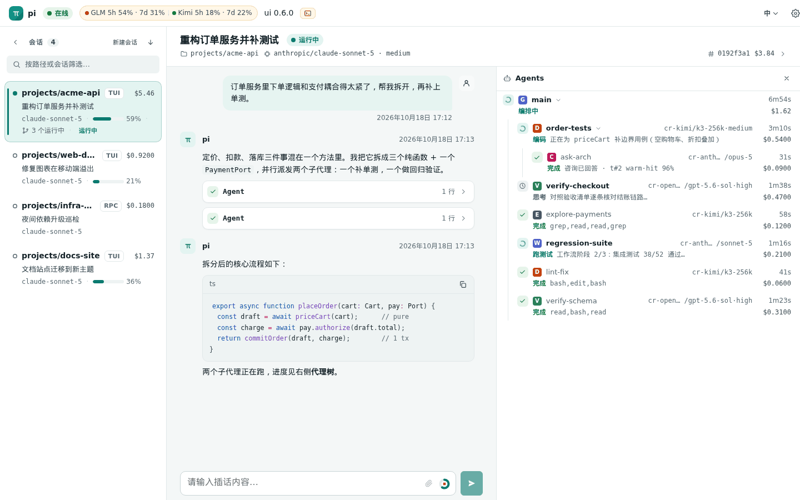

# pi-toolkit

**中文** | [English](README.en.md)

[pi](https://github.com/earendil-works/pi) 的工具箱扩展。旗舰是一套**零卡死 subagent 系统**（`Agent` / `get_subagent_result` / `steer_subagent` / `SubagentWorkflow`），外加一组可按需开关的日常模块：项目记忆、上下文交接与缓存保活、额度与负载感知、bash 自动转后台、任务工具、`/goal`、飞书通知，以及可选的浏览器控制面（Web Hub）。单一安装入口，统一 settings 门控。

<p align="center">
  
  <br>
  <sub>Web UI：会话列表、对话、代理树（阶段 / 成本 / consult 缓存命中）与订阅额度一屏可见</sub>
</p>

<p align="center">
  
  
  
  
  <br>
  <sub>深色主题 · 手机端（会话列表 / 对话 / 代理抽屉）</sub>
</p>

## 核心特点

<p align="center">
  
  <br>
  <sub>终端内：代理树小组件 + HUD 页脚</sub>
</p>

1. **零卡死** — 每个 subagent run 是一条带分相 deadline 的纯状态机：1Hz 看门狗触发超时，升级阶梯（cancel → steer → abort → dispose）回收资源，杀不掉的登记为 orphan。每个 run 必然到达终态。
2. **可观测** — 编辑器上方常驻实时 agent tree（相位、在途工具、流式尾部、实时费用）；`/agent status` 给出逐 run 的工具时间线；Web Hub 里同样可见。
3. **结果必达** — 完成通知走持久化、可确认的投递管线，不会静默丢失。
4. **派完即走** — 主会话的 `Agent` 和 `SubagentWorkflow` 一律后台运行，立即返回 id，完成通知驱动下一步；bash 命令超过阈值（默认 290 秒）自动转后台，进程不杀。
5. **工具箱，不是单体** — 除 subagent 核心外，每个模块都能独立开关，装一个包按需取用。

## 安装

pi 直接加载 TypeScript 源码（经 jiti），无需构建：

```sh
pi install git:github.com/Newbluecake/pi-toolkit
# 更新：
pi update --extension git:github.com/Newbluecake/pi-toolkit
```

也可以从 [GitHub Releases](https://github.com/Newbluecake/pi-toolkit/releases) 下载总 zip。下载后解压，并在解压目录执行：

```sh
cd pi-toolkit
npm install --omit=dev
pi install .
```

总 zip 可直接作为本地 pi 扩展安装（本地路径方式，不参与 `pi update`）。Web UI 另有 `pi-toolkit-web-ui-<version>.zip` 附件：手工解压到 `~/.pi/agent/`，即可安装到 `~/.pi/agent/web-hub-ui/<version>/`，无需重启 hub。

## 模块总览

详细用法在 [`docs/guide/`](docs/guide/)（中文）；内部设计在 [`docs/dev/`](docs/dev/)。

| 模块                      | 说明                                                                                                                                                                                                                                                                                                                                                                                                       | 指南                                                             |
| ------------------------- | ---------------------------------------------------------------------------------------------------------------------------------------------------------------------------------------------------------------------------------------------------------------------------------------------------------------------------------------------------------------------------------------------------------- | ---------------------------------------------------------------- |
| Subagent 工具             | `Agent` / `get_subagent_result` / `steer_subagent` / `abort_subagent` / `extend_subagent_timeout` / `set_model`，后台运行、可延长超时、可 worktree 隔离。                                                                                                                                                                                                                                                  | [subagents](docs/guide/subagents.md#工具)                        |
| Agent tree                | 编辑器上方的实时 subagent 树：相位、工具轨迹、费用、超时高亮。                                                                                                                                                                                                                                                                                                                                             | [subagents](docs/guide/subagents.md#agent-tree)                  |
| SubagentWorkflow          | 沙箱化 JS 编排（`agent()` / `parallel()` / `pipeline()`），后台运行，带 journal 回放。默认关闭。                                                                                                                                                                                                                                                                                                           | [subagents](docs/guide/subagents.md#subagentworkflow)            |
| 定时任务（`schedule`）    | 归属会话的 cron / 一次性任务：后台 subagent 出报告或定时消息；AI 建的任务须你批准；报告可推飞书。默认关闭。                                                                                                                                                                                                                                                                                                | 本文 [定时任务](#定时任务schedule)                               |
| 防卡死架构                | 分相 deadline、升级阶梯、orphan 登记、持久化通知投递。                                                                                                                                                                                                                                                                                                                                                     | [subagents](docs/guide/subagents.md#防卡死架构)                  |
| Message fabric            | subagent 间沿 agent tree 的 fire-and-forget 消息（`message_agent`）。默认关闭。                                                                                                                                                                                                                                                                                                                            | [subagents](docs/guide/subagents.md#message-fabric)              |
| consult 专家咨询          | 子 agent 在一轮内同步咨询已结束的专家 run 或主会话（`consult`）。                                                                                                                                                                                                                                                                                                                                          | [subagents](docs/guide/subagents.md#consult-专家咨询)            |
| 外部 droid agent          | 把 Factory droid 当作 `droid/<model>` 虚拟 provider 派发，带模型白名单与额度闸门。默认关闭。                                                                                                                                                                                                                                                                                                               | [subagents](docs/guide/subagents.md#外部-droid-agent)            |
| 项目记忆                  | cwd 为键的被动记忆，分层注入 + `memory` 工具 + `/mem doctor` / `tidy`。                                                                                                                                                                                                                                                                                                                                    | [memory](docs/guide/memory.md)                                   |
| bash 自动转后台           | 覆盖内置 `bash`：长命令转后台不杀，`bash_job` 管理，宽限与续期。                                                                                                                                                                                                                                                                                                                                           | [bash](docs/guide/bash.md)                                       |
| 上下文交接与用量提示      | `switch_context` / `compact_context`，用量阶梯提示与强制线。                                                                                                                                                                                                                                                                                                                                               | [context](docs/guide/context.md#switch_context--compact_context) |
| cache TTL 与保活          | Anthropic prompt cache 的 TTL 模式与保活 ping，带熔断与证据层。                                                                                                                                                                                                                                                                                                                                            | [context](docs/guide/context.md#cache-ttl-与保活)                |
| system prompt 稳定化      | 动态段落折叠成冻结快照，变化走尾部更新消息，保住缓存前缀。                                                                                                                                                                                                                                                                                                                                                 | [context](docs/guide/context.md#system-prompt-稳定化)            |
| 日期注入                  | 首轮、跨日和长闲置后给模型注入 `[date]`。                                                                                                                                                                                                                                                                                                                                                                  | [context](docs/guide/context.md#date-日期注入)                   |
| 额度感知                  | GLM / Kimi 订阅与 droid Standard / Core 池额度：阶梯预警、派发闸门、Core→Standard 回落。                                                                                                                                                                                                                                                                                                                   | [quota-load](docs/guide/quota-load.md#额度感知quota)             |
| 负载感知                  | CPU / 内存 / IO / 磁盘采样，本机繁忙时暂缓新派发。                                                                                                                                                                                                                                                                                                                                                         | [quota-load](docs/guide/quota-load.md#负载感知派单load)          |
| 任务工具                  | `TaskCreate` 等五个工具 + widget + `/tasklist`，完成项折叠与自动归档。                                                                                                                                                                                                                                                                                                                                     | [tools](docs/guide/tools.md#任务工具todo)                        |
| `/goal`                   | 目标驱动循环：确定性命令或 verifier subagent 判定，带轮数 / 预算 / 时长刹车。                                                                                                                                                                                                                                                                                                                              | [tools](docs/guide/tools.md#goal-目标循环)                       |
| `ask_user` / `web_search` | 结构化交互提问；四供应商 failover 的联网搜索。                                                                                                                                                                                                                                                                                                                                                             | [tools](docs/guide/tools.md#ask_user)                            |
| HUD footer                | 接管 pi 底部 footer：git、token / 费用、上下文、额度 / 负载。                                                                                                                                                                                                                                                                                                                                              | [tools](docs/guide/tools.md#hud-footer)                          |
| 飞书通知                  | 被动触发的结果 / 汇总 / 心跳卡片（`@notify`、`/watch`）。                                                                                                                                                                                                                                                                                                                                                  | [tools](docs/guide/tools.md#飞书通知)                            |
| 会话导航                  | `/resume-recent`、`/clear`、裸 `exit`，会话标题清洗。                                                                                                                                                                                                                                                                                                                                                      | [tools](docs/guide/tools.md#会话导航)                            |
| topic-switch              | 新请求与当前会话无关且缓存已冷时，建议开新会话。                                                                                                                                                                                                                                                                                                                                                           | [tools](docs/guide/tools.md#topic-switch)                        |
| 自动标题 / 延迟 `/reload` | 小模型生成会话标题；有 subagent 在跑时延后 `/reload`。                                                                                                                                                                                                                                                                                                                                                     | [tools](docs/guide/tools.md#自动标题)                            |
| Web Hub（可选）           | 浏览器查看与控制会话：网页发消息、`ask_user` 竞速（对话框内路径可点开预览，单选题可取消已选项）、托管会话与恢复、文件 / HTML 沙箱预览、本机端口代理、worktree diff / 图、版本面板、LAN 密码与安全（IP 白名单、二次验证、登录会话管理、飞书安全告警）、隐私锁、命令输出进会话历史、已结束 agent / bash 归档、定时任务面板；可安装为 PWA（[安装到手机 / 桌面](docs/guide/web-hub.md#安装到手机--桌面pwa)）。 | [web-hub](docs/guide/web-hub.md)                                 |
| 加密会话（pi-secure）     | gocryptfs 保险库：项目与会话记录加密落盘，插件守护拦截跨域读写。未配置时零接线。                                                                                                                                                                                                                                                                                                                           | 本文 [加密会话](#加密会话pi-secure)                              |
| 流量录制（traffic）       | `/record` 把 provider 请求 / 响应 / 流式 chunk 录进本地 SQLite，票据归属 + jq 改写规则 + 加固的网页查看 / 重放。默认关闭。                                                                                                                                                                                                                                                                                 | 本文 [流量录制](#流量录制traffic)                                |
| 从独立插件迁移            | 旧插件的卸载与残留识别。                                                                                                                                                                                                                                                                                                                                                                                   | [migration](docs/guide/migration.md)                             |

## 命令

| 命令                                                                      | 内容                                                                                                                                                         |
| ------------------------------------------------------------------------- | ------------------------------------------------------------------------------------------------------------------------------------------------------------ |
| `/agent`（`status [runId]` / `costs` / `settings` / `budget` / `reload`） | 运行诊断、费用明细、设置编辑器、延迟 reload                                                                                                                  |
| `/task <描述>`                                                            | 启动一个后台 general-purpose subagent                                                                                                                        |
| `/goal`                                                                   | 目标循环（`status` / `pause` / `resume` / `clear`）                                                                                                          |
| `/mem`                                                                    | 项目记忆：`list` / `path` / `import` / `doctor` / `tidy` / `restore`                                                                                         |
| `/tasklist`                                                               | 任务面板（`clear` 清空）                                                                                                                                     |
| `/cache-ttl`                                                              | `on` / `off` / `auto` / `save` / `keepalive on\|off\|reset` / `status` / `probe`                                                                             |
| `/topic-switch`                                                           | 查看状态（`status`），`last [--send]` 取回上次截留的请求                                                                                                     |
| `/webhub`                                                                 | `status` / `open` / `restart` / `stop` / `start` / `token rotate` / `passwd` / `unlock` / `2fa` / `user` / `feishu`                                          |
| `/schedule`                                                               | 定时任务（需 `schedule.enabled`）：`list` / `add` / `edit` / `show` / `log` / `approve` / `pause` / `resume` / `rm` / `run` / `repair`，`--all` 管理其他会话 |
| `/watch`                                                                  | 本会话每次任务结束都通知飞书                                                                                                                                 |
| `/feishu-test`                                                            | 发送飞书测试卡片                                                                                                                                             |
| `/pi-hud-refresh`                                                         | `git fetch` 并刷新 HUD                                                                                                                                       |
| `/resume-recent`                                                          | 恢复最近 48 小时的会话（`--all` 全量）                                                                                                                       |
| `/secure status`                                                          | 加密会话判定与挂载状态（配置过 `secure` 段才注册）                                                                                                           |
| `/record`                                                                 | 流量录制：`on` / `off` / `status`（需 `traffic.enabled`，Node ≥22.13；网页端 `on` 需确认）                                                                   |
| `/clear`                                                                  | 开新会话                                                                                                                                                     |

## 配置

用户配置文件：`~/.pi/agent/pi-subagent.json`（沿用历史文件名；缺失或格式错误一律用默认值，不抛错）。

- `/agent settings` 打开交互式编辑器（↑↓ 选择、回车编辑、空格切换布尔、`r` 重置默认，改动即时落盘）；脚本场景用 `/agent settings list` / `set <key> <value>` / `reset <key>`。
- **时间字段通常以整数秒配置**（键名以 `S` 结尾，如 `budget.idleS`）；旧版毫秒键首次加载时自动迁移。例外：下表 `feishuBot.debounceMs` 保持毫秒，不迁移。
- 各模块的详细键与默认值见对应指南。

顶层启用开关（括号内为默认值）：

```jsonc
{
  "workflow": { "enabled": false }, // SubagentWorkflow
  "fabric": { "enabled": false }, // message_agent
  "worktree": { "enabled": false }, // isolation: "worktree"
  "memory": { "enabled": true },
  "hud": { "enabled": true },
  "webSearch": { "enabled": true },
  "todo": { "enabled": true },
  "askUser": { "enabled": true },
  "feishuNotify": { "enabled": true },
  "sessionNav": { "enabled": true },
  "goal": { "enabled": true },
  "consult": { "enabled": true },
  "quota": { "enabled": true },
  "load": { "enabled": true },
  "topicSwitch": { "enabled": true },
  "date": { "enabled": true },
  "externalAgents": { "droid": { "enabled": false } },
  "webHub": { "enabled": false },
  "feishuBot": { "enabled": false }, // 飞书机器人；依赖 Web Hub 控制面
  "traffic": { "enabled": false }, // 流量录制（/record；需 Node ≥22.13）
  "schedule": { "enabled": false }, // 定时任务（/schedule + schedule 工具）
}
```

`web_search` 的供应商凭证在另一处，见 [tools 指南](docs/guide/tools.md#web_search)。

### 飞书机器人设置（可选）

以下为 `pi-subagent.json` 的**顶层** `feishuBot.*`（不是 `webHub.feishuBot`）；改动后 `/reload` → `/webhub restart`，还需 `webHub.enabled:true` 与控制面开启。[配置/命令/安全说明](docs/dev/feishu-bot/README.md) · [真租户验收](docs/dev/feishu-bot/acceptance.md)。**一个应用只连接一个 hub**，双连接会分流事件。

| 键                              | 默认值    | 含义                                                       |
| ------------------------------- | --------- | ---------------------------------------------------------- |
| `feishuBot.enabled`             | `false`   | 总开关，默认仅 owner 可用。                                |
| `feishuBot.allowGroups`         | `true`    | 接收群内 @ 请求。                                          |
| `feishuBot.groupRootTopics`     | `false`   | 群根 @ 时开未绑定话题，随后显式 /use 或 /new。             |
| `feishuBot.notify`              | `"bound"` | bound / off，已绑定会话的主动 done/failed/waiting 提醒。   |
| `feishuBot.spawnScope`          | `"known"` | known 拒绝未知目录；roots 经路径确认；/new 另需 spawn。    |
| `feishuBot.debounceMs`          | `1500`    | 0–10000 **毫秒**；JSON-only，不在 TUI 设置编辑器展示。     |
| `feishuBot.staleMessageS`       | `300`     | 30–3600 秒，拒绝过旧请求。                                 |
| `feishuBot.files.outbound`      | `"auto"`  | auto / buttons / off；仅归属明确的私聊 cwd 图片自动发送。  |
| `feishuBot.files.inbound`       | `true`    | 接收入站图片/文件附件。                                    |
| `feishuBot.files.maxInboundMiB` | `30`      | 解析范围 1–100 MiB，实际仍受共享上传的 30 MiB 上限约束。   |
| `feishuBot.securityAlerts`      | `true`    | LAN 安全告警：新 IP 登录、白名单拒绝、会话下线、2FA 变更。 |

## 定时任务（schedule）

给当前会话挂 cron 或一次性任务：到点派一个后台 subagent 在干净上下文里跑，最后一条回复就是报告；也可以到点给会话自己发一条消息。默认关闭（`schedule.enabled`，非 live，改完 `/reload`）。关闭时没有 `schedule` 工具、没有 `/schedule` 命令、system prompt 与状态栏都不变。设计见 [scheduled-reports 方案](docs/dev/scheduled-reports/plan.md)。

> 旧版 `~/.pi/agent/pi-subagent-schedules.json` 的全局定时引擎已退役，不再读取也不再写入。

**形式**

- `background`：后台 subagent 执行，结果以一条消息写回归属会话（AI 之后可引用）。默认不叫醒主会话，任务可设「完成后让主会话接手」（`--handoff`）；可选 `--consult` 让它咨询归属会话。默认推飞书。
- `message`：到点给归属会话发一条消息；会话忙时排队，同一任务只留最新一条。默认不推飞书。
- `message` 形式和 `--handoff` 依赖宿主 pi 提供的触发能力：能力缺失时，把任务新建或改成这两种形式会被拒（`E_UNSUPPORTED`）；已有这类任务时状态栏显示 `msg off`。由定时消息或接手触发的主会话运行最长 3600 秒，到时自动中止（期间有人工插话则解除上限），不可配置。
- 每个会话最多 8 个任务。
- 时间：5 段 cron（`--cron`）或一次性（`--at YYYY-MM-DDTHH:mm`），按任务时区（`--tz`，IANA 名）计算。

**归属与错过**

- 任务属于创建它的会话，只在该会话（交互式主会话）打开时才计时和执行。到点时会话没开着就**跳过**，不补跑、不拉临时会话。
- 下次打开会话时有一条摘要说明错过了什么；`hub` 开着且飞书机器人可用时，每个任务每小时合并推一条「已错过」。
- 运行中会话被关掉，记为「结果未知」并通知，不会重跑。
- 加密会话、`--no-session`、subagent 子会话不执行；print / json 模式只能查看。

**批准**

- 你用 `/schedule add` 创建的任务直接生效。
- **AI 通过 `schedule` 工具创建或修改的任务必须由你批准**：批准绑定任务定义的哈希（`defHash`），之后任何来源改了时间、形式或 prompt 等执行字段，旧批准自动失效。AI 没有批准动作，`resume` 只取消暂停，也不等于批准。
- 批准：终端里 `/schedule approve <id>`，会展示完整定义和哈希，确认后才落批准；也可以在网页面板里审阅批准。编辑一个还没批准的任务，不会顺带批准它。

**命令**

| 子命令                                                                     | 作用                                                                                                                                                             |
| -------------------------------------------------------------------------- | ---------------------------------------------------------------------------------------------------------------------------------------------------------------- |
| `/schedule [list] [--all]`                                                 | 列出本会话（`--all`：所有会话）的任务                                                                                                                            |
| `/schedule add <名称> --cron "<表达式>" \| --at <时间> [选项] -- <prompt>` | 创建；选项：`--tz` `--form background\|message` `--feishu` / `--no-feishu` `--type` `--model` `--thinking` `--timeout <秒>` `--consult` `--handoff` `--worktree` |
| `/schedule edit <id> [选项] [-- <prompt>]`                                 | 修改（仅本会话）                                                                                                                                                 |
| `/schedule show <id>` / `log [<id>]`                                       | 完整定义与哈希 / 运行历史                                                                                                                                        |
| `/schedule approve <id> [<hash>]`                                          | 审阅并批准                                                                                                                                                       |
| `/schedule pause\|resume\|rm <id>`                                         | 暂停 / 恢复 / 删除；暂停和删除会一并撤销该任务已排队、尚未发出的定时消息                                                                                         |
| `/schedule run <id>`                                                       | 立即运行一次（仅本会话、仅已批准任务）                                                                                                                           |
| `/schedule repair`                                                         | 隔离损坏的账本；账本正常时重置卡住的定时消息调度（对话框计数、会话栅栏）。仅本地终端可用，网页调用一律拒绝；启用跨会话时 `/fabric fence reset` 也会做同样的重置  |

`--all` 可对其他会话的任务做 list / show / log / pause / resume / rm / approve；`edit` 和 `run` 只能在归属会话里做。

**可见性**

- AI 工具 `schedule`：`list` / `get` / `create` / `update` / `pause` / `resume` / `delete` / `run_now` / `history`。
- system prompt 里有会话级的任务定义段（只含定义，不含下次运行时间，不破坏缓存前缀；fork 出的会话不继承）。
- TUI 状态栏形如 `sched 2 · next 08:00 · run 1 · pending 1`。
- 网页：详情头的「定时」按钮打开面板，列出任务、运行记录与待确认项；首期以只读为主，唯一的写操作是批准。需要 `webHub.enabled`。

**飞书**

- 后台任务的报告由 Web Hub 推送给飞书机器人的 owner 私聊，需要 `feishuBot` 与 Web Hub 控制面（见上文「飞书机器人设置」）。hub 停机或本地模式期间完成的报告，hub 恢复后补推 24 小时内的。
- 在飞书私聊里发 `/schedule` 得到只读任务列表，`/schedule run <序号>` 立即运行（要求归属会话在线，否则回复不在线）。飞书入口不能创建、修改或批准任务。

**设置**（均非 live）

| 键                         | 默认值  | 含义                                                          |
| -------------------------- | ------- | ------------------------------------------------------------- |
| `schedule.enabled`         | `false` | 总开关。                                                      |
| `schedule.defaultTimeoutS` | `1800`  | background 任务未指定 `--timeout` 时的超时，60–14400 秒整数。 |
| `schedule.maxTimeoutS`     | `14400` | 任务 `--timeout` 上限，60–14400 秒整数（硬上限）。            |
| `schedule.dir`             | 空      | 绝对路径，仅 JSON；缺省为 `~/.pi/agent/schedules`。           |

首期不提供开机自启 hub：想让「会话不在线」的错过提醒生效，需要 hub 自己在跑。

## 加密会话（pi-secure）

把项目连同它的全部会话记录放进一个 gocryptfs 加密目录（保险库）：挂载后正常使用，卸载后磁盘上只剩密文。插件做轻量守护——加密会话写不到库外、普通会话读不到库内。**这是加固，不是「绝不写明文」的承诺**：web-hub / 飞书里的明文副本、swap、终端回滚等残留见[设计文档](docs/dev/data-encryption/plan.md) §5。

### 前提与安装

- Linux（依赖 FUSE）；
- `gocryptfs` ≥ 1.8（Ubuntu 22.04 可直接 `sudo apt install gocryptfs`）、`fusermount3`、`flock`（util-linux 自带）；
- 安装启动器（把仓库内的启动器链接到 `~/.local/bin`，确保该目录在 PATH 里）：

  ```sh
  ln -s <仓库路径>/src/secure/bin/pi-secure ~/.local/bin/pi-secure
  # git 安装的仓库路径通常是 ~/.pi/agent/git/github.com/Newbluecake/pi-toolkit
  ```

  配置过保险库后，会话内 `/secure status` 也会打印这条安装命令（未配置时该命令不注册）。

### 初始化

```sh
pi-secure init acme        # 需要真实终端；会提示输入两次新口令
```

- **master key 只在 init 时由 gocryptfs 在终端打印一次**（64 个十六进制字符），务必当场抄写并离线保存——口令丢失且没有 master key 时数据无法恢复。工具本身不读取、不保存口令与 master key。
- 打印后建议执行 `clear` 和 `tmux clear-history`（尽力清理终端回滚，算不上安全擦除）。
- init 会自动完成首次挂载、创建目录、登记保险库并写好项目 sessionDir，结束时自动卸载。
- init 失败会自己收拾：`gocryptfs -init` 失败（例如两次新口令不一致）时，自动撤销登记并删除本次创建的对象，逐条报告（证明不了归属的保留并提示手工清理）。首次挂载口令连错 3 次（退出码 77）时，在终端里询问是否删除刚建好的空库，回答 `y` 才删；其他输入或非 TTY 则保留，之后用 `pi-secure init <名> --fix-settings` 补齐。

### 迁移已有项目：`convert`（推荐）

```sh
pi-secure convert ~/ai/acme acme   # 需要真实终端：键入库名确认 + 三次口令（init 两次、挂载一次）
pi-secure status acme              # origin: ~/ai/acme · backup: ~/ai/acme.pi-secure-backup-… (still present)
```

- 一条命令完成：建库 → 拷入（含 `.git`）→ 经挂载逐文件读回校验、`git fsck` → 复制会话与 memory（源文件不动）→ 写项目 sessionDir → 原路径换成指向 `~/secure/acme/work` 的符号链接。解锁期间旧绝对路径照样能用。
- **原目录不删除**：它被改名为同级的只读备份 `acme.pi-secure-backup-<时间>-<4位>`。`status` 会一直提醒它存在，并给出删除命令。确认保险库内容无误后**由你自己删除**；旧会话和旧 memory 也一样（SSD / CoW 上删除不等于擦除）。
- 前置：`getfattr`（`sudo apt install attr`）、git。家目录和挂载点的各级祖先目录不得对组或其他用户可写，否则在任何确认和口令之前就报 78。
- 带 ACL/xattr、setgid、他组文件、linked worktree、树内挂载的目录会被拒绝（65），并逐条列出原因。中断后 `pi-secure convert --resume acme`（只完成链接）或 `--abort acme`（备份改回原名）。
- 被拒的项目可以退回手工迁移：`pi-secure init acme` → `pi-secure unlock acme` → `rsync -a ~/ai/acme/ ~/secure/acme/work/` → `pi-secure run acme --version`（冒烟，不带 `--` 分隔）；旧会话用 `pi-secure run acme --fork <旧会话的绝对路径>` 导入；最后自行删除原目录并更新各处绝对路径。

### 导出与导入（换机器 / 旧布局库迁移）

```sh
pi-secure export acme ~/acme.tar                    # 库须未挂载；包只含密文，与密文目录同样敏感
pi-secure import ~/acme.tar acme --verify-password  # 校验后发布为新库，验证口令并完成迁址
pi-secure init acme --fix-settings                  # 导入时没带 --verify-password：用它完成迁址
pi-secure import --resume acme                      # 导入中断后继续；--abort 撤销
```

- 包的读取会校验路径白名单、大小预算、头校验与 MANIFEST；不合格 ⇒ 65，零残留。挂载点位置变了时，迁址（改写会话头、memory 目录、sessionDir）完成前 `run` / `unlock` / `export` 会被拒绝。
- 旧布局库（`status` 提示 `layout legacy`）只能 `export`，再 `import` 成新名字的新布局库；确认无误后再删旧库。
- 完整说明（流程、`status` 各显示项、退出码、中断恢复、`.aborted-<txid>` / `.init-failed-*` 的清理）见[设计文档](docs/dev/data-encryption/plan.md) §2.9「转换与迁移」；真机验收清单见 [acceptance](docs/dev/data-encryption/acceptance.md) K–M 节。

### 日常使用

| 命令                           | 作用                                                                                                           |
| ------------------------------ | -------------------------------------------------------------------------------------------------------------- |
| `pi-secure run acme`           | 解锁（提示口令）→ 在项目根启动 pi → pi 退出后自动尽力卸载（10 秒有界收尾；卸不掉会告警并保留挂载）             |
| `pi-secure run acme -C sub`    | 从项目的子目录 `sub` 启动（任意目录都可调用，不必先 cd）                                                       |
| `pi-secure unlock acme`        | 挂载；已挂载则直接返回。之后在项目根直接 `pi` 也可以（sessionDir 已写进项目设置）                              |
| `pi-secure lock acme [--lazy]` | 有界卸载；`--lazy` 延迟卸载（有占用者时仍可卸）                                                                |
| `pi-secure status [acme]`      | 挂载状态、布局完整性、swap / core 警告、traffic-record 适配；转换/导入未完成、迁址待完成、备份仍在时另有提示行 |

会话内用 `/secure status` 查看判定、锁定原因、各保险库挂载状态与 traffic-record 适配情况。

### 私有模式（--private）

默认（普通模式）下，解锁后的保险库对**所有同用户进程**可见。`--private` 把明文挂载改进为：只存在于本次 pi 进程树的**私有挂载命名空间**里，其他程序按路径只能看到哨兵占位文件。

```sh
pi-secure init demo --private        # 登记为私有库（此后 run 缺省即私有）
pi-secure run demo --private         # 单次私有运行；--no-private 强制普通模式
pi-secure lock demo --lazy           # 摘除该命名空间里的挂载路径（既有访问可能继续）
pi-secure lock demo --kill           # 结束 --private 会话并收尾
pi-secure unlock demo --global       # 私有库默认拒绝全局解锁，--global 仅解除这条默认
```

- `--private`/`--no-private` 只在紧跟库名的位置识别；缺省取 `secure.vaults.<名字>.private`。
- `run` 结束（或 `lock --kill`）后自动收尾：终止有证明归属的进程、卸载、释放记录与租约，退出码透传 pi。
- web-hub 不会在私有会话内拉起（会被困在命名空间里）；需要网页时在普通终端的 pi 里执行 `/webhub start`。
- 详细的进程链、互斥规则、实例状态与退出码见[设计文档](docs/dev/data-encryption/plan.md) §2.8 与 [private-plan](docs/dev/data-encryption/private-plan.md)；真机验收清单见 [acceptance](docs/dev/data-encryption/acceptance.md) J 节。

安全边界（统一措辞，与 `pi-secure --help` 一致）：

> --private：明文挂载只存在于本次 pi 进程树的私有挂载命名空间里。其他程序按路径访问保险库只会看到占位文件，find/grep/备份工具/其他 agent 的无意识访问都会被挡住。它不能防御同一用户下有意的恶意进程：这类进程可以经 /proc/<pid>/root、/proc/<pid>/cwd 读到明文，或用 setns 加入该命名空间。若需要硬边界，请用独立的系统用户运行 pi-secure。

### 注意事项

- **`--fork` / `--session` / `@file` 一律用绝对路径**：相对路径按 pi 的 cwd（库内）解析。
- **注册新保险库后需重启 pi 进程**：`pi-secure init` 写入的登记在 `/reload` 后不会重新判定。
- 加密会话**不能写保险库外**（write/edit 被拦截，bash 尽力而为）；普通会话**不能读保险库**（read/write/edit/grep/find/ls 与 bash 命令文本被拦截）。
- worktree 隔离在加密会话中被拒绝；飞书通知卡片、跨会话消息（xs）、droid、cron 新建在加密会话中关闭。
- traffic-record 需 **v0.2.1+**（声明遵守 `PI_SECURE_SESSION=1`）：旧版本会把请求正文写进明文 traffic.db，`/secure status` 会警告。
- 运行中保险库被外部卸载 ⇒ 会话转为 LOCKED（输入与工具全部拦截）；重新挂载后重开会话即可。
- 未挂载时 `~/secure/acme` 指向一个普通文件，`cd` 会失败——这是设计使然（哨兵）。
- pi 原生 `/debug` `/export <库外路径>` `/share` `/copy`、绕过 `pi-secure` 直接在子目录里跑 `pi`，这些路径插件拦不到；一律走 `pi-secure run`。完整残留清单见[设计文档](docs/dev/data-encryption/plan.md) §5。

### 故障排除

| 症状                                 | 处理                                                                                                                                       |
| ------------------------------------ | ------------------------------------------------------------------------------------------------------------------------------------------ |
| `lock` 报 busy / EBUSY，列出占用 pid | 有进程的 cwd 还在库内（IDE、shell 等）：退出后重试 `pi-secure lock <name>`；不急的话用 `--lazy` 延迟卸载                                   |
| `status` 显示 stale（ENOTCONN）      | gocryptfs 守护进程异常退出：`pi-secure unlock <name>` 会先清理再重新挂载，或 `pi-secure lock <name>` 清理                                  |
| 退出码 75「卸载未完成」              | 保险库可能仍挂载：稍后 `pi-secure status` 查看，再 `pi-secure lock <name>`；必要时手动 `fusermount3 -uz <dir>/mnt`                         |
| 退出码 77                            | 口令连错 3 次（间隔 1s/2s/4s），重新执行命令                                                                                               |
| 退出码 73                            | 另一个 pi-secure 正在挂载/卸载（mount.lock 被占），稍后重试                                                                                |
| 状态栏 `secure:locked`、输入被拦     | 会话被 LOCKED：保险库未挂载、会话与所属库不一致或跨域打开。按提示重开（如 `pi-secure run acme -C sub`）；LOCKED 不会自动退出，`/quit` 可用 |
| 状态栏 `secure:invalid`              | `pi-subagent.json` 的 `secure` 段无法解析：修复 JSON 后重启 pi                                                                             |

## 流量录制（traffic）

把发往 provider 的请求与响应（含流式 chunk）录进本地 SQLite：`~/.pi/agent/records/traffic.db`，与独立插件 pi-traffic-record 同库同表，历史、改写规则与计数自动沿用。配合 jq 改写规则和一个加固的网页查看 / 重放界面。默认关闭，开启需 Node ≥22.13（`node:sqlite`）；off 时零注册、零 IO。内部设计见 [traffic-merge 方案](docs/dev/traffic-merge/plan.md)，真机验收清单见 [acceptance](docs/dev/traffic-merge/acceptance.md)。

- 命令：`/record on` / `off` / `status`，在主会话注册（包括 print / json 模式），子会话不注册；print / json 模式只录制、不启动网页服务、不能重放；网页端执行 `on` 需要确认。
- 请求归属靠一次性票据头（铸造后在上游 fetch 层剥离，provider 看不到）；改写只作用于能证明归属的请求，无法证明的按原样发送并记 `unattributed`。改写白名单：anthropic-messages / openai-completions / openai-responses（Codex 的 WS 握手绕过 fetch，票据剥不掉，只能录不改写）。
- 库内含 API key 明文（原设计），文件本身不加密——录制默认关，请自行控制本机访问。
- 网页默认只绑 `127.0.0.1`（4177 起，被占用自增）；全部 `/api/*` 要 token（回环也不例外），响应带反嵌入 / no-store 头；会话结束（含 `/reload`）中止在途重放。

### 配置

| 键                      | 默认值      | 含义                                                                         |
| ----------------------- | ----------- | ---------------------------------------------------------------------------- |
| `traffic.enabled`       | `false`     | 总开关；off ⇒ 零注册、零 IO、不加载 `node:sqlite`。                          |
| `traffic.childSessions` | `true`      | 子会话请求是否落库。`false` 只禁止落库，**不**禁止子会话请求被改写规则作用。 |
| `traffic.web.host`      | `127.0.0.1` | 绑定地址；`"0.0.0.0"` 显式开启 LAN（见下方风险）。                           |
| `traffic.web.port`      | `4177`      | 起始端口，被占用自增，最多 20 次。                                           |

以上键均非 live：改完 settings 文件后 `/reload` 生效；库路径固定在 `~/.pi/agent/records/traffic.db`，不随 `PI_CODING_AGENT_DIR`，也无可配置项。

### 数据范围（拍板①）

开启后默认**也录子 agent 流量**：consult fork、`/goal` verifier、workflow 子 agent 的完整 prompt 与输出都会落库，数据量约随子 agent 用量线性增长。toolkit 自身的保活 ping、额度查询、会话标题、topic 判定请求结构上不经过录制钩子，不录也不改写（拍板⑥）。另有两点共存行为：改写规则启用期间，cache 保活 ping 被否决（HUD 显示 `ping off:traffic-rewrite`）、pi 原生 cache warming 被叫停；观测到 warming 决策后改写会暂停（fail closed，`/record status` 可见），`/record off → on` 恢复。

### LAN 风险

`traffic.web.host = "0.0.0.0"` 会把查看 / 重放页面开放给同网段，但走的是**明文 HTTP**：token、请求正文与 API key 都可被同网段嗅探。Host 白名单与 token 校验不替代传输加密；需要跨机访问时建议走 SSH 隧道并保持默认绑定。

### 从独立 pi-traffic-record 迁移

1. 所有运行中的 pi 执行 `/record off`。
2. 升级 pi-toolkit。
3. 从 `~/.pi/agent/settings.json` 的 `packages` 删掉 `"../../ai/pi-traffic-record"`（装过 `~/.pi/agent/extensions/traffic-dump.ts` 的一并删）。
4. `~/.pi/agent/pi-subagent.json` 写 `"traffic": { "enabled": true }`（或用 `/agent settings`）；需要 LAN 再加 `"web": { "host": "0.0.0.0" }`。
5. **重启 pi**（只 `/reload` 不够）。
6. 验证：只有一个 `/record`；`/record status` 计数与迁移前一致（库、规则、引擎设置在 DB 中自动沿用）；网页历史可浏览。
7. 回滚：`traffic.enabled=false` 并把 package 加回去（另一个进程仍在跑旧版时，两者可共享同一个库，schema 不变）。

暂时保留外部包也可以：toolkit 只在「确有活动的外部录制器」时让位——旧版 v0.2.x 实际在跑 ⇒ toolkit 让位并在 session_start 提示从 settings 移除；外部墓碑版 v0.3.0 则反过来对 toolkit 让位。任何加载顺序下活动录制器都恰为 1，不会双写。

## 开发

```sh
npm install
npm run build        # tsc → dist/
npm test             # vitest：17,000+ 测试（状态机迁移矩阵、属性不变量、组件渲染……）
npm run typecheck
npm run format
```

Node.js ≥ 22。版本化 pre-commit hook（对暂存文件跑 prettier）：`git config core.hooksPath .githooks`。仓库结构与各子系统的设计约束见 [AGENTS.md](AGENTS.md)，逐功能的设计文档在 [`docs/dev/`](docs/dev/)。

## License

MIT
